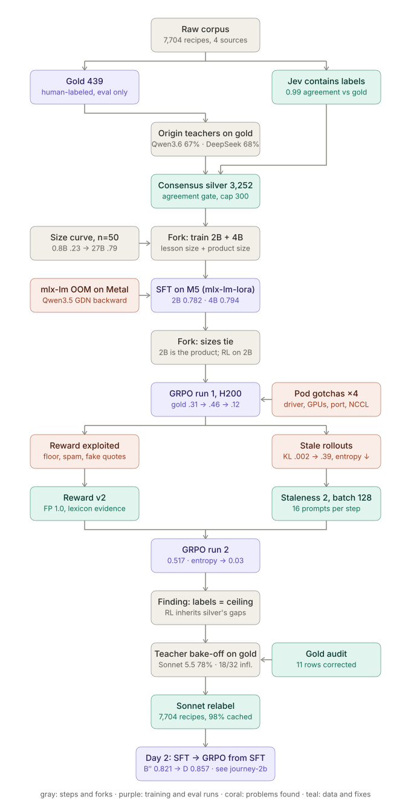
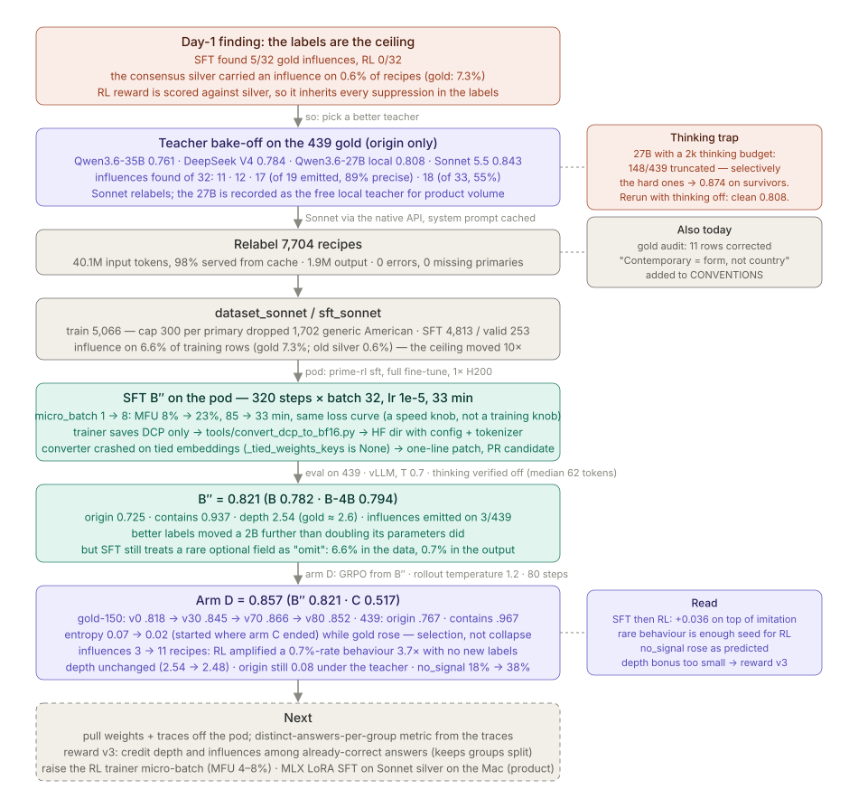

# prime-recipe-classifier

Post-training a 2B model to classify recipes against a controlled culinary taxonomy — origin tradition path plus
ingredient-class `contains` — on Prime Intellect's stack (`verifiers` v1 environment, `prime-rl` GRPO), with every arm
evaluated on one human-labeled gold set under one scoring function.

The interesting part is not the classifier. It is what the RL loop exposed about the reward, the data and the training
setup, and how each finding changed the next run. The dated record is in [`LOG.md`](LOG.md); the analysis in
[`TRAINING.md`](TRAINING.md).





## Results — 2B unless noted, reward v2, audited gold

| arm | 439 gold | 350 public subset | notes |
|---|---|---|---|
| A. base (Qwen3.5-2B, v3 prompt) | 0.244 | 0.249 | zero-shot |
| B. SFT, consensus silver (LoRA, 2 epochs, M5) | 0.782 | 0.785 | |
| B. SFT 4B, same data | 0.794 | 0.802 | not distinguishable from 2B (paired diff +0.013 ± 0.010) |
| C. GRPO from base (prime-rl, 1× H200, 23 steps) | 0.517 | — | +0.27 from reward alone; plateaued (entropy 0.39 → 0.03) |
| **B″. SFT on Sonnet-5.5 silver** (full FT, prime-rl, 1× H200, 33 min) | **0.821** | — | origin 0.725 · contains 0.937 · depth 2.54 (gold ≈ 2.6); better labels moved the 2B more than doubling parameters did |
| **D. GRPO from B″** (prime-rl, 1× H200, T 1.2, 80 steps, 2 h 12 m) | **0.857** | — | origin 0.767 · contains 0.967 · influences 3 → 11 recipes; entropy 0.07 → 0.02; gold-150 peaked 0.866 at step 70 |

Reward = 0.55 · origin (hierarchical set-Jaccard over the taxonomy path, influence term) + 0.45 · contains
(recall-weighted, lexicon-grounded evidence). Specification and history in [`TRAINING.md`](TRAINING.md#reward-v2-2026-11-08--after-arm-c-exposed-three-exploits).

## What failed, and what changed

| observed | diagnosed as | changed |
|---|---|---|
| gold 0.46 → 0.12 while train reward rose; rollouts listing every class, quoting unrelated ingredients, always claiming `incomplete` | reward exploits: flat floor, FP cheaper than FN, substring "evidence" | reward v2: `incomplete` must match gold; FP cost 1.0; evidence must be a real ingredient *and* lexicon-supported for the class; spam cap |
| mismatch KL 0.002 → 0.39, grad norm 5 vs clip 1, repetition to the token cap | stale rollouts: single-GPU inference ran ~10× ahead of the trainer | `max_staleness` 8 → 2, batch 64 → 128 episodes |
| train reward flat at ~0.5, entropy → 0.03, one distinct answer per group | premature convergence; no advantage signal | arm D: start from SFT, rollout temperature 1.2 → entropy 0.07 → 0.02 *with* gold rising +0.036; no_signal groups 18% → 38% over the run |
| SFT influences 5/32, RL influences 0/32 | labels are the ceiling: consensus silver had an influence on 0.6% of recipes (gold 7.3%) | teacher bake-off on gold (table below) → Sonnet 5.5 relabel → silver at 6.6% → B″ 0.821 |
| local 27B teacher: 148/439 answers truncated with a 2k thinking budget, and the survivors scored *higher* | thinking budget fails selectively on the hard recipes → survivorship bias | re-run with thinking off (clean 0.808); never compare a truncated run's score |
| pod SFT at 15.8 s/step, MFU 8% | `micro_batch_size=1`: 32 sequences pushed through one at a time | micro-batch 8 → 6.2 s/step, MFU 23%, identical loss curve |
| `convert_dcp_to_bf16.py` TypeError on the SFT checkpoint | prime-rl tool iterates `_tied_weights_keys`, which is `None` on Qwen3.5-2B (tied embeddings) | one-line patch (`or []`); upstream PR candidate |
| 9 gold `contains` labels the verifier could not ground | gold errors (extract-only alcohol, gelatin ≠ pork) | audited 11 rows; all arms re-scored |

Teacher comparison on the 439 gold (`label_origin compare`): Qwen3.6-35B 67.4% exact / 11 influences · DeepSeek V4 68.5% / 12 ·
Claude Sonnet 5.5 78.1% / 18 · qwen3.6:27b (local) pending.

## What arm D says about SFT vs RL

Same labels, same reward, same 2B. SFT on the Sonnet silver (B″) got 0.821 by imitation. GRPO from that checkpoint, with no
new labels, added +0.036 by comparing its own samples. Where the gain came from: origin +0.042 (more exact paths on fusion and
regional recipes), `contains` +0.030 (fewer spurious classes), and influences emitted on 11 recipes instead of 3 — a behaviour
the SFT model produced on 0.7% of outputs although 6.6% of its training rows carried one. RL amplified a rare behaviour 3.7×
because the reward's influence term made the one sibling that emitted an influence beat the seven that did not. What RL did
not do: deepen paths (2.54 → 2.48; the 10% depth bonus is too small against the Jaccard's shallow-path safety), or close the
teacher gap (origin 0.767 vs Sonnet's 0.843 on the same gold — the headline 0.857 includes `contains`, whose labels are better
than the origin labels). RL from the base model alone (arm C) reached 0.517.

## Teachers measured on the gold set

Origin labels for the training set come from an LLM teacher, so the teacher's own accuracy against gold is the ceiling
for everything trained on it. Each candidate labeled the 439 gold recipes with the same prompt (`label_origin compare`):

| teacher | where | primary exact | origin score | gold influences found (of 32) | emitted | notes |
|---|---|---|---|---|---|---|
| Qwen3.6-35B-A3B | Prime Inference | 67.4% | 0.761 | 11 | 13 | 19 parse errors |
| DeepSeek V4 | Prime Inference | 68.5% | 0.784 | 12 | 14 | first silver (consensus with Qwen3.6 → 0.6% influences) |
| Qwen3.6-27B, thinking on, 2k budget | local Ollama, M5 | 80.1% *of 291 answered* | 0.874 | 2 of 7 | 4 | **148 truncated** — survivorship bias: the same model with room to finish scores 0.826 |
| Qwen3.6-27B, thinking off | local Ollama, M5 | 72.6% | 0.808 | 17 | 19 | ~77 output tokens/recipe; the free local option |
| Qwen3.6-27B, thinking on, 6k budget | local Ollama, M5 | 74.5% | 0.826 | 17 | 21 | all 439 answered; ~1,865 output tokens/recipe (24×) for +0.018 |
| **Claude Sonnet 5.5** | Anthropic API | **78.1%** | **0.843** | **18** | 33 | chosen; relabeled 7,704 recipes with 98% of input tokens from prompt cache |

Two things this table taught: a teacher's *influence precision* and *recall* are different axes (the 27B names an influence
only when sure, 89% precision; Sonnet finds one more but at 55%); and a thinking budget that truncates is not a worse
version of the same measurement, it is a different sample. Caveat on all rows: the teacher was chosen *by* its gold score,
so the table mildly overfits the 439; a held-out slice would make the choice clean.

## Layout

```
taxonomy.yaml                     245 origin nodes, 20 contains classes, derived diets, ingredient traps
env/recipe_tax/                   scoring (reward), lexicon, taxonomy loader, dataset build, SFT prep, teacher labeling
env/environments/recipe_classify/ verifiers v1 Taskset/Task; configs/ (vf-run local/ollama/mlx, prime-rl rl/sft/eval)
env/tests/                        12 tests on the reward
scripts/                          pod setup/sync (driver, GPU, port, NCCL gotchas scripted), eval runners, this export
data/                             publishable subset only (see Data)
LOG.md / TRAINING.md / TAXONOMY.md / OVERVIEW.md / PLAN.md
```

## Hardware and where each step ran

- **Mac (M5, 128 GB)**: all 439-recipe evaluations (base models via Ollama, fine-tuned models via `mlx_lm.server`), the size
  curve (Qwen3.5 0.8B → 27B zero-shot), SFT for 2B and 4B (`mlx-lm-lora`, LoRA r8 on 16 layers, ~1.7 h / ~3.2 h), the
  local 27B teacher evaluation, and all data/label tooling. Evals are fast because the ~3k-token system prompt is prefix-cached.
- **Rented 1× H200 (Prime Intellect compute, ~$6.7/h)**: GRPO with `prime-rl`, trainer and vLLM sharing the one GPU
  (`CUDA_VISIBLE_DEVICES=0,0`, filesystem weight broadcast); the B″ full fine-tune (`prime-rl sft`, 33 min) and its
  439-recipe eval through vLLM; arm D. The SFT trainer saves DCP checkpoints only — `tools/convert_dcp_to_bf16.py`
  produces the HF directory vLLM and arm D load.
- **Hosted APIs**: Prime Inference for the first two origin teachers (DeepSeek V4, Qwen3.6-35B); Anthropic API for the
  Sonnet 5.5 teacher (native Messages API with prompt caching: 98% of the 40M relabel input tokens were cache reads); TypeSafe Jev for `contains` labels.

## Reproduce

```bash
cd env && uv sync
uv run python -m pytest -q tests                                          # reward unit tests
uv run vf-validate recipe-classify                                        # gold self-scores 1.0
# baseline against a local Ollama model:
bash ../scripts/vf_run_ollama.sh qwen3.5:2b 350
# SFT on Apple silicon (mlx-lm-lora; mlx-lm's own trainer OOMs on Qwen3.5's GatedDeltaNet backward):
uv run python -m recipe_tax.sft_prepare && mlx_lm_lora.train --model Qwen/Qwen3.5-2B --train --train-mode sft \
  --data ../data/sft --mask-prompt --batch-size 4 --gradient-accumulation-steps 2 --iters 1600 --learning-rate 1e-5 \
  --max-seq-length 3584 --grad-checkpoint --num-layers 16 --adapter-path ../runs/sft-2b
# SFT on the pod with prime-rl (full fine-tune), then export HF weights (the trainer only saves DCP):
uv run sft @ env/environments/recipe_classify/configs/sft-2b-sonnet.toml --no-monitors.prime
uv run python tools/convert_dcp_to_bf16.py outputs/<run>/checkpoints/step_320      # -> .../step_320/weights
# GRPO on one GPU with prime-rl (see configs/rl-2b.toml comments for the single-GPU flags):
CUDA_VISIBLE_DEVICES=0,0 uv run rl @ env/environments/recipe_classify/configs/rl-2b.toml --inference.vllm.gpu-memory-utilization 0.45
```

## Data

- **Gold** (`data/gold/gold.jsonl`, 350 of 439): human-labeled by the author; the policy never trains on it.
- **Train** (`data/dataset/`, `data/dataset_dsv4/`, `data/dataset_sonnet/`): silver labels — `contains` from TypeSafe Jev
  (0.99 vs gold), origin from LLM teachers. Consensus set (two-teacher agreement), single-teacher DeepSeek set (no gate),
  and the Sonnet 5.5 set that B″ and arm D train on (influence on 6.6% of rows vs 0.6% in the consensus set).
- **Raw** recipes: Food.com (CC0) and Wikibooks Cookbook (CC BY-SA 3.0; each record carries its `source` URL). The 89 gold and
  ~460 train recipes captured from the author's own app are excluded from this repository; the private 439-recipe numbers are
  reported alongside the 350-recipe public numbers above.
- Labels and derived data in this repo: CC BY 4.0. Code: MIT ([LICENSE](LICENSE)).

## How this was built

Directed, labeled and decided by Jasdeep Jaitla; code and most analysis written with Claude as a pair, over roughly one
weekend. Every decision, mistake and reversal is in [`LOG.md`](LOG.md) with a date — including the model's own errors
(a rename it claimed to have applied and had not; a reward design that RL took apart in 35 steps). That record is the point.
