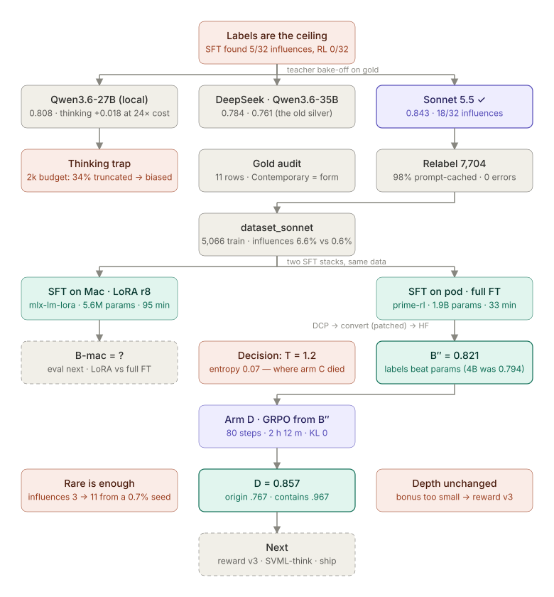

# prime-recipe-classifier

Post-training a 2B model to classify recipes against a controlled culinary taxonomy — origin tradition path (hierarchical classification like Europe > Spain > Basque) plus ingredient-class `contains` — on Prime Intellect's stack (`verifiers` v1 environment, `prime-rl` GRPO), with every arm evaluated on one human-labeled gold set under one scoring function.

There were many interesting parts of this process; the one that mattered most for training is what the RL loop exposed about the reward, the data and the training setup, and how each finding changed the next run. The dated record is in [`LOG.md`](LOG.md); the analysis in
[`TRAINING.md`](TRAINING.md).


# Phase 1 and Phase 2

## Phase 2 went back to the data

Phase 1 ended with every arm converging on the same ceiling: the 2B and 4B SFT models were within noise of each other (0.782 vs 0.794), the RL run plateaued below both, and all of them found at most 9 of the 32 recipe influences (the harder challenge) in the gold set while the training labels carried an influence on only 0.6% of recipes. 

It became clear we need to look at the label data on the silvers. Scaling parameters or RL steps against those labels
could only converge on them. So the next step was better data: measure every candidate teacher against
the human gold, pick the best, relabel. Along the way the verifier flagged `contains` labels in the gold set itself that it
could not ground (vanilla extract-only labelled with `alcohol`, gelatin as `pork`); 11 gold rows were corrected and every arm re-scored. 

The relabel moved the influence rate from 0.6% to 6.6%, the SFT ceiling from 0.78 to 0.82, and gave RL something it could amplify.



(Detailed version with the numbers behind each box: [`journey-2.svg`](journey-2.svg).)

## Reward V1 Hacking vs V2

> In V1, the reward paid a flat fee (0.5 on `contains`) for saying "incomplete," and the model learned to use it as an escape hatch on every recipe.

V2 only pays for "incomplete" when the gold label also says the ingredient list is incomplete; claiming it otherwise scores 0.

> In V1 a missed allergen cost 2.0 but an extra false one cost only 0.5 — for allergens a miss is worse than an over-warning.

The model's precision was too low for that ratio: padding the list with extra allergens scored higher than an honest list with one miss. V2 doubled the false-positive cost to 1.0, counts duplicates, and zeroes the score above 10 classes.

> In V1, the evidence check only asked whether the quoted string was a real ingredient, not whether that ingredient supports the claimed allergen, so `"egg": "tur dal"` passed.

It was a real ingredient, just not tied to the allergen — so every padded entry came with "evidence." V2 requires the quoted ingredient to be in the lexicon for the claimed class, so the reward is tied to a legitimate ingredient→allergen link.

The model found all three: it said "incomplete" everywhere, padded the allergen list when it didn't, and pointed at random ingredients as evidence. Its training score went up while its accuracy on the human gold set fell from 0.46 to 0.12 — that divergence is the signature of reward hacking.

## Results — 2B unless noted, reward v2, audited gold

| arm | 439 gold | 350 public subset | notes |
|---|---|---|---|
| A. base (Qwen3.5-2B, v3 prompt) | 0.244 | 0.249 | zero-shot |
| B. SFT, consensus silver (LoRA, 2 epochs, M5) | 0.782 | 0.785 | |
| B. SFT 4B, same data | 0.794 | 0.802 | not distinguishable from 2B (paired diff +0.013 ± 0.010) |
| C. GRPO from base (prime-rl, 1× H200, 23 steps) | 0.517 | — | +0.27 from reward alone; plateaued (entropy 0.39 → 0.03) |
| **B″. SFT on Sonnet-5.5 silver** (full FT, prime-rl, 1× H200, 33 min) | **0.821** | — | origin 0.725 · contains 0.937 · depth 2.54 (gold ≈ 2.6); better labels moved the 2B more than doubling parameters did |
| B″-mac. same labels, LoRA r8 on 16 layers (mlx-lm-lora, M5, 95 min) | 0.782, 0.769 (two draws) | — | origin 0.702 · contains 0.880 · 16 influences emitted; gap to full FT is mostly `contains` (same labels) → LoRA capacity. Control: full-FT weights through MLX = 0.817, so the two eval stacks agree |
| **D. GRPO from B″** (prime-rl, 1× H200, T 1.2, 80 steps, 2 h 12 m) | **0.857** | — | origin 0.767 · contains 0.967 · influences 3 → 11 recipes; entropy 0.07 → 0.02; gold-150 peaked 0.866 at step 70 |

Reward = 0.55 · origin (hierarchical set-Jaccard over the taxonomy path, influence term) + 0.45 · contains
(recall-weighted, lexicon-grounded evidence). Specification and history in [`TRAINING.md`](TRAINING.md#reward-v2-2026-11-08--after-arm-c-exposed-three-exploits).

## What failed, and what changed

| observed | diagnosed as | changed |
|---|---|---|
| gold 0.46 → 0.12 while train reward rose; rollouts listing every class, quoting unrelated ingredients, always claiming `incomplete` | reward exploits: flat floor, FP cheaper than FN, substring "evidence" | reward v2: `incomplete` must match gold; FP cost 1.0; evidence must be a real ingredient *and* lexicon-supported for the class; spam cap |
| mismatch KL 0.002 → 0.39, grad norm 5 vs clip 1, repetition to the token cap | stale rollouts: single-GPU inference ran ~10× ahead of the trainer | `max_staleness` 8 → 2, batch 64 → 128 episodes |
| train reward flat at ~0.5, entropy → 0.03, one distinct answer per group | premature convergence; no advantage signal | arm D: start from SFT, rollout temperature 1.2 → entropy 0.07 → 0.02 *with* gold rising +0.036; no_signal groups 18% → 38% over the run |
| SFT influences 5/32, RL influences 0/32 | labels are the ceiling: consensus silver had an influence on 0.6% of recipes (gold 7.3%) | teacher bake-off on gold (table below) → Sonnet 5.5 relabel → silver at 6.6% → B″ 0.821 |
| local 27B teacher: 148/439 answers truncated with a 2k thinking budget, and the survivors scored *higher* | thinking budget fails selectively on the hard recipes → survivorship bias | re-run with thinking off (clean 0.808); never compare a truncated run's score |
| pod SFT at 15.8 s/step, MFU 8% | `micro_batch_size=1`: 32 sequences pushed through one at a time | micro-batch 8 → 6.2 s/step, MFU 23%, identical loss curve |
| `convert_dcp_to_bf16.py` TypeError on the SFT checkpoint | prime-rl tool iterates `_tied_weights_keys`, which is `None` on Qwen3.5-2B (tied embeddings) | one-line patch (`or []`); upstream PR candidate |
| 9 gold `contains` labels the verifier could not ground | gold errors (extract-only alcohol, gelatin ≠ pork) | audited 11 rows; all arms re-scored |

Teacher comparison on the 439 gold (`label_origin compare`): Qwen3.6-35B 67.4% exact / 11 influences · DeepSeek V4 68.5% / 12 ·
Claude Sonnet 5.5 78.1% / 18 · qwen3.6:27b (local) pending.

## What arm D says about SFT vs RL

> Recipe Influences are important for any fusion recipes that combine elements from different cultures. The recipe can have a primary technique or form from one culture, but influenced by another. Reversing this is incorrect and penalized. (See: https://saffronsifu.app/r/0PWWrU7RhpdsiWwvGrQQAF which is Japanese in form, but Korean in influence)

Using the same labels, same reward, same 2B. SFT on the Sonnet silver (B″) got 0.821 by imitation. GRPO from that checkpoint, with no
new labels, added +0.036 by comparing its own samples. Where the gain came from: origin +0.042 (more exact paths on fusion and
regional recipes), `contains` +0.030 (fewer spurious classes), and influences emitted on 11 recipes instead of 3 — a behaviour
the SFT model produced on 0.7% of outputs although 6.6% of its training rows carried one. RL amplified a rare behaviour 3.7×
because the reward's influence term made the one sibling that emitted an influence beat the seven that did not. 

> Classification Depth is a hierarchy like South Asian > Indian > Punjabi instead of just South Asian, or just Indian, or just Punjabi, which each get partial credit in the reward function if present, and any incorrect depth at any level is zero credit.

What RL did not do: deepen paths (2.54 → 2.48; the 10% depth bonus is too small against the Jaccard's shallow-path safety), or close the
teacher gap (origin 0.767 vs Sonnet's 0.843 on the same gold — the headline 0.857 includes `contains`, whose labels are better
than the origin labels). RL from the base model alone (arm C) reached 0.517.

## Teachers measured on the gold set

Origin labels for the training set come from an LLM teacher, so the teacher's own accuracy against gold is the ceiling
for everything trained on it. Each candidate labeled the 439 gold recipes with the same prompt (`label_origin compare`):

| teacher | where | primary exact | origin score | gold influences found (of 32) | emitted | notes |
|---|---|---|---|---|---|---|
| Qwen3.6-35B-A3B | Prime Inference | 67.4% | 0.761 | 11 | 13 | 19 parse errors |
| DeepSeek V4 | Prime Inference | 68.5% | 0.784 | 12 | 14 | first silver (consensus with Qwen3.6 → 0.6% influences) |
| Qwen3.6-27B, thinking on, 2k budget | local Ollama, M5 | 80.1% *of 291 answered* | 0.874 | 2 of 7 | 4 | **148 truncated** — survivorship bias: the same model with room to finish scores 0.826 |
| Qwen3.6-27B, thinking off | local Ollama, M5 | 72.6% | 0.808 | 17 | 19 | ~77 output tokens/recipe; the free local option |
| Qwen3.6-27B, thinking on, 6k budget | local Ollama, M5 | 74.5% | 0.826 | 17 | 21 | all 439 answered; ~1,865 output tokens/recipe (24×) for +0.018 |
| **Claude Sonnet 5.5** | Anthropic API | **78.1%** | **0.843** | **18** | 33 | chosen; relabeled 7,704 recipes with 98% of input tokens from prompt cache |

Two things this table taught: a teacher's *influence precision* and *recall* are different axes (the 27B names an influence
only when sure, 89% precision; Sonnet finds one more but at 55%); and a thinking budget that truncates is not a worse
version of the same measurement, it is a different sample. Caveat on all rows: the teacher was chosen *by* its gold score,
so the table mildly overfits the 439; a held-out slice would make the choice clean.

> We may revisit the gold varieties and increase fusion recipe % and more diversity to see if that creates overfitting/memorization or generalization.

# Phase 3

## Taxonomy Depth

The next phase of training and reward will involve training depth recognition so that hierarchical categories in the taxonomy are met. For instance instead of stopping at two levels, `South Asian > Indian`, a dish like `Galouti Kebab` would be 4 levels: `South Asian > Indian > North Indian > Awadhi`.

## New High Level Taxonomy

There is ambiguity between `American | Contemporary | Fusion`. There was also a top level category called Unplaced which meant it doesn't have a deep cultural origin, but we didn't like this label so we changed `Unplaced -> Global`. `Foundational`, `Contemporary` and the new `Fusion` are one level down from Global.

We decided that Fusion isn't a primary dish + influence (like Bulgogi Burgers is American + Korean Influence in ingredients only) instead it must be a `Dish x Dish` which means two different dishes fused together like Chicken Tikka Pesto Penne (Global > Fusion || Italian + Indian influences). In the latter case it is a cross between two Dishes, not just adding an ingredient (like gochujang) or a marinade, but rather two dishes "Fused" together, each still there as itself. The test: could you lift the second dish out and serve it on its own?

Fusion, Contemporary and American is the perfect blurred area that can illuminate the training, training reward, and consistency/inconsistency that we are trying to train through our taxonomy rules. 

## Phase 3 Dataset

| | Phase 2 | Phase 3 |
|---|---|---|
| Training recipes | 5,066 | 5,774 |
| Test recipes, original gold | 439 | 439 |
| Test recipes, hard set (fusion, ownership, regional depth) | none | 224 |
| Training labels with a `Fusion` primary | 0 | 29 |
| Training labels with an influence | 148 | 207 |
| Training labels three levels deep or more | 2,157 | 2,671 |

Both gold sets are held out of training. The hard set and the newly sourced recipes are not redistributable, so they are not in this repo.

## Baseline before training

Before training anything new we scored the Phase 2 fine-tune (B″, full fine-tune on Sonnet labels) on the hard set, so Phase 3 has something to beat. Same weights, same sampling, same scorer. The hard set ran on the Mac (MLX) and the original gold on the pod (vLLM); the two stacks agree within noise on the 439 (0.817 vs 0.821).

| | Hard set (224), on the Mac | Original gold (439), on the pod |
|---|---|---|
| Overall reward | 0.735 | 0.821 |
| Origin | 0.607 | 0.727 |
| Contains | 0.892 | 0.937 |
| Exact origin match | 45% | 63% |

The hard set by the kind of recipe:

| Slice | Recipes | Origin score | Exact match |
|---|---|---|---|
| Un-named fusion | 30 | 0.285 | 13% |
| Ownership cases (adapted abroad, rewrites, two claimants) | 108 | 0.640 | 55% |
| Regional depth (one recipe per thin regional node) | 86 | 0.679 | 44% |

What the baseline says:

- **Fusion is where the old model fails outright.** It never answers `Fusion` (0 of 10) and offers an influence on 7 recipes where gold has 45.
- **Depth is not the problem we assumed.** Its answers are as deep as gold on average (2.65 levels vs 2.63). On the regional recipes it was exact on 38, stopped short on 17, and on 18 went to the right depth but picked the wrong node. The weakness is choosing the right region, more than daring to go deep.
- **The taxonomy and reward change did not move the old numbers.** Re-scoring the saved Phase 2 answers under taxonomy 0.4.0 and reward v3 gives B″ 0.821 and D 0.857, the same as recorded, so Phase 3 can be compared directly on the original 439.

What we expect from Phase 3, written down before the run:

- **Original 439:** about level with D (0.857), within the ~0.02 noise band. Those labels barely changed.
- **Hard set:** a clear gain over 0.735, mostly from fewer wrong-region answers and from `Fusion` being answered at all.
- **Influences:** more of them offered than D's 11, because reward v3 charges less for a wrong guess.

One caution on reading the result: a single evaluation of 439 recipes has about ±0.013 of sampling noise, more on 224, and much more on the 30 fusion recipes. Only large moves on the small slices mean anything.


## Phase 3 results

One fine-tune on the Phase 3 data, then 80 steps of GRPO from it with reward v3. Same schedule as arm D, so the differences are the labels, the data and the reward.

| Model | Original 439: reward | origin | exact | Hard 224: reward | origin | exact |
|---|---|---|---|---|---|---|
| B″, Phase 2 fine-tune | 0.821 | 0.727 | 63% | 0.735 | 0.607 | 45% |
| D, Phase 2 GRPO | 0.849 | 0.749 | 64% | 0.765 | 0.641 | 47% |
| Phase 3 fine-tune | 0.821 | 0.728 | 63% | 0.738 | 0.634 | 47% |
| **E, Phase 3 GRPO** | 0.837 | 0.739 | 66% | **0.786** | **0.696** | **53%** |

Origin on the hard set, by kind of recipe:

| Slice | D | E |
|---|---|---|
| Ownership cases (108) | 0.685 | 0.73 |
| Un-named fusion (30) | 0.317 | 0.47 |
| Regional depth (86) | 0.698 | 0.73 |

What moved:

- **The hard set, on origin.** +0.055 over D and +0.09 over the Phase 2 fine-tune. The hard set was evaluated twice and the two runs agree to 0.001 on reward.
- **Influences.** E matches a gold influence exactly on 15 to 20 of the 45 hard recipes that have one; D matched 6. It adds one where gold has none once.
- **Fusion.** E answers `Fusion` 6 times on the hard set (3 right, 3 wrong; gold has 10) and finds all 3 on the original gold with the right parents. No earlier model ever answered it.

What did not:

- **The original 439 is level with D** (0.837 vs 0.849), as predicted before the run. The gap is in `contains` (0.956 vs 0.971); origin is within noise and exact match is 2 points higher.
- **The fine-tune alone did not beat the Phase 2 fine-tune on reward.** It gained on origin and lost the same amount on `contains`. The GRPO stage recovered most of that.

What we learned about the method:

- **The in-training score misled us.** The 150-recipe gold sample logged every 10 steps moved from 0.868 to 0.872 over the run, which looked like nothing. The full evaluation shows +0.06 origin on the hard set. A sample drawn only from the easy set, blending both reward terms, cannot see where the model is improving.
- **This model has two jobs and one of them belongs elsewhere.** `contains` is handled better by a dedicated system. Phase 4 tests what dropping it would do before Phase 5 trains on origin only.

### How the gain arrived

The same hard-set evaluation, run on weights saved during the GRPO stage:

| GRPO step | Hard 224: reward | origin |
|---|---|---|
| 0 (the Phase 3 fine-tune) | 0.738 | 0.634 |
| 60 | 0.776 | 0.682 |
| 70 | 0.775 | 0.677 |
| 80 | 0.786 | 0.696 |

Most of the gain is in by step 60. Step 70 to 80 still adds 0.019 on origin, almost all of it on the ownership recipes (64 to 70 exact of 108), against a repeatability of about 0.002 for this evaluation. The model was still improving when the run stopped, so 80 steps was too short. `Fusion` is the exception: the model answers it 6 times (3 right) at all three steps, and the fusion slice peaked at step 60.

The token-level analysis of these two models (near and blind misses, what GRPO did to confidence, how much of the reward was about origin) is in Phase 4.

### What broke on the way

Three failures, none of them about the model. Each cost time, and each is now a rule in the setup scripts.

- **Disk.** On prime-rl `4c12d15` a trainer checkpoint for the 2B model is about 25 GB. The fine-tune kept four and the first GRPO checkpoint filled a 200 GB disk at step 20. The disk had been sized from Phase 2, when a whole run took 33 GB. Fix: `--trainer.ckpt.keep-last 1`, and one final checkpoint for the fine-tune.
- **Lost weights.** Enlarging the disk on the rented pod restarted it and erased everything on the local disk, including the finished fine-tune, which had not been copied off yet. The fine-tune was rerun (it is seeded, and the losses matched to three decimals). Fix: every finished artefact goes to the persistent volume and to a second machine as soon as it exists.
- **Memory at start-up.** Continuing the run from step 80 was killed twice. The cause was container RAM. The environment config uses `runtime.type = "subprocess"`, which starts one Python process per attempt in flight. While the trainer is busy with its slow first step, the dispatcher raises concurrency to about 4,350, and we counted 4,536 Python processes holding about 256 GiB against a 251 GB limit. The 80-step run had passed through the same spike with slightly fewer in flight. Next run: cap the number of attempts in flight and watch RAM through the first step. The continuation to 120 steps was not completed.

# Phase 4: back to the basics

Phase 4 was planned as another training run: drop `contains` from the 2B model's job and train on origin alone. Before renting a GPU we ran the baselines for that change on a laptop, and the baselines raised better questions than the run would have answered. So Phase 4 became an analysis phase with no training in it. After three phases of changing labels, rewards and taxonomies, it asks what the problem is made of.

The questions, in the order they came up:

1. **One job or two?** Does a model classify origin better when it does not also have to list allergens?
2. **What is the model reading?** The title, the ingredients, or would the method help?
3. **What kind of wrong is it?** When the model misses, was the right answer its second choice, or was it never considered?
4. **What did the reward teach?** How much of the GRPO signal in Phase 3 was about origin?

Everything here ran on the Mac against saved weights and saved training attempts, plus about 7 million Sonnet input tokens (97% cached).

## One job or two: what the instructions alone change

Every model we could run locally answered both gold sets twice: once with the full instructions (origin and `contains`) and once with the origin-only instructions. None of these models has been trained on the task. Sonnet 5.5 is the model that labelled the training data. Origin score, full instructions → origin only:

| Model, untrained | Original 439 | Hard 224 |
|---|---|---|
| Qwen3.5-2B | 0.330 → 0.407 | 0.295 → 0.312 |
| Qwen3.5-4B | 0.577 → 0.560 | 0.467 → 0.457 |
| Qwen3.5-9B | 0.600 → 0.658 | 0.480 → 0.582 |
| Qwen3.5-27B | 0.783 → 0.781 | 0.741 → 0.761 |
| Sonnet 5.5 (the label teacher) | 0.850 → 0.855 | 0.889 → 0.891 |
| *E, the trained 2B from Phase 3, full instructions* | *0.739* | *0.696* |

The paired difference per recipe has a standard error of about 0.02 on either set, so only the 2B on the original gold and the 9B on both are clear moves.

What the baselines say:

- **The effect is real for the weaker models and absent for the strong ones.** The 2B and 9B gain; the 27B and Sonnet do not move.
- **Part of the weak-model gain is format, not judgment.** With the full instructions the 2B and 9B sometimes reason about allergens in the answer itself and run out of room (18 and 32 of 439 answers unusable). Counting only recipes where both answers were usable, the gain shrinks to +0.06 for the 2B and +0.02 for the 9B on the original gold. A fine-tuned model no longer makes that mistake, so this part will not carry over to a fine-tuned model.
- **The 4B's small drop is one missing bracket.** Under origin-only instructions it left the closing `}` off 40 of 439 answers, which score zero. On the answers usable both ways it is 0.62 against 0.60. As a what-if only (the scorer is unchanged), repairing that bracket and re-scoring gives 0.621 on the original gold and 0.496 on the hard set, against 0.577 and 0.467 with the full instructions. A fine-tune fixes this for free.
- **Size buys origin skill at every step.** Untrained, origin only: 0.41, 0.62 (4B repaired), 0.66, 0.78 on the original gold and 0.31, 0.50, 0.58, 0.76 on the hard set. The largest step is 2B to 4B. The hard set separates the sizes more than the original gold does: the 2B loses 0.10 moving to it and the 27B loses 0.02.
- **The teacher's ceiling does not change** (0.855 and 0.891), so the training labels do not need redoing.
- **With one job, models offer more influences.** Sonnet added an influence where gold has none on 38 recipes, against 17 with the full instructions; the 9B offered 47 against 14. Reward v3 charges 0.2 for each, so this is worth watching in training.
- **The distance still to cover.** On the hard set the trained 2B is at 0.696, the untrained 27B at 0.761 and Sonnet at 0.891.

So the clean part of the one-job gain for a small model is a few points at most, and fine-tuning has already removed the format failures that produce the rest.

## What the model is reading

The model is shown a title and a list of ingredient names. To see which one it uses, we changed only the recipe text and left the instructions and labels alone. Origin score:

| | Title only | Ingredients only | Both (as trained) | Both plus method |
|---|---|---|---|---|
| Hard 224: Sonnet 5.5 | 0.881 | 0.772 | 0.891 | 0.887 |
| Hard 224: Qwen3.5-27B, untrained | 0.736 | 0.482 | 0.761 | 0.763 |
| Hard 224: E, the trained 2B | 0.659 | 0.383 | 0.696 | |
| Original 439: Qwen3.5-27B, untrained | 0.748 | 0.477 | 0.781 | |
| Original 439: E, the trained 2B | 0.721 | 0.421 | 0.739 | |

- **The title carries almost everything.** Removing the ingredients costs 0.01 to 0.04. Removing the title costs 0.12 to 0.32. On both gold sets and for every model, this task is mostly recognising the dish by name.
- **The method adds nothing.** Every recipe in the corpus has one and we had never shown it. For the two strong models it changes the score by less than the noise (Sonnet: 7 recipes better, 11 worse), so it stays out and nothing needs relabelling.
- **The small model is much weaker at reading the food than at recognising names.** From ingredients alone the trained 2B is 0.39 behind Sonnet on the hard set; with the title it is 0.19 behind. On the regional recipes it gets 40 of 86 exactly right from the title alone and 4 of 86 from the ingredients alone.
- **This explains the blind misses** (next section). More than half of the Phase 3 model's mistakes gave the gold answer under 1%. Those are dish names the 2B does not know. GRPO cannot teach a name, and neither can removing `contains`.
- **Some recipes cannot be decided from the text at all.** Hummus has the same title and the same ingredients in every country that claims it. Where the claimants share a node the taxonomy rule is to stop there, but Greek, Egyptian, Turkish and Levantine sit under different top-level regions, so gold has to pick one. These should not count as errors; we have not yet counted how many there are.

## What kind of wrong: the model's probabilities

Scores say how often the model is wrong. Token probabilities say what kind of wrong. For each hard-set recipe we took the model's top answer (temperature 0), then fed the gold origin back in token by token and read the exact probability the model gave it (`scripts/logprob_probe.py`). Almost all of the JSON is certain. The uncertainty sits on a few tokens, and each is a decision: which node, go deeper or stop (`",` against `"],`), add an influence or finish.

A wrong answer is a **near miss** if the gold answer had at least 10%, **possible** at 1 to 10%, and **blind** under 1%.

| Hard set, 224 recipes, top answer | Phase 3 fine-tune | E, after GRPO |
|---|---|---|
| Origin score | 0.651 | 0.688 |
| Same answer as gold | 104 | 110 |
| Near misses | 21 | 13 |
| Possible | 35 | 18 |
| Blind misses | 64 | 83 |
| Typical confidence in its own answer | 63% | 98% |

What GRPO did with each kind of miss the fine-tune made:

| Under the fine-tune | Recipes | Right after GRPO |
|---|---|---|
| Already right | 104 | 98 |
| Near miss | 21 | 7 |
| Possible | 35 | 5 |
| Blind | 64 | 0 |

- **GRPO only promotes answers the model was already considering.** It fixed a third of the near misses and none of the blind ones. An answer the model never tries is never rewarded.
- **Fusion is a data problem.** 22 of E's 24 wrong fusion recipes are blind, and the training set has 29 `Fusion` examples. More GRPO steps will not reach them.
- **GRPO made the model certain, right or wrong.** On the recipes E still gets wrong, the gold answer's probability fell on 101 of 114, typically to 3% of what it was. After the fine-tune, answers held at 95 to 99% confidence were right 87% of the time; after GRPO, 52%. If the product wants to flag doubtful answers, the fine-tune's confidence is the usable one.
- **Part of the gain reported above is sharpening.** With sampling at temperature 0.7 the gap between the fine-tune and E is 0.062 on origin. Taking each model's top answer it is 0.037: the fine-tune loses 0.017 to sampling and E loses nothing. The Phase 3 results table is sampled; the product should use the top answer.
- **Where the misses are.** For both models the largest group is the top-level region (50 and 45 recipes). Depth decisions are next and are the closest calls: where the fine-tune stopped one level short, it gave "go deeper" at least 10% in 13 of 17 cases. After GRPO "stopped short" grew from 17 to 28: under partial credit, stopping early is the safer answer and the model learned it.
- **A rule that did not work.** Cutting the answer back to the parent whenever the deeper level is uncertain does not raise the score at any threshold. Low-confidence deep answers are right about as often as wrong.

## How much of the training signal was about origin

GRPO learns only from differences inside a group of eight attempts at one recipe. From E's saved attempts (`scripts/reward_signal_split.py`):

| Steps | Within-group reward variance from origin | from `contains` | Groups with no signal | Same, had the reward been origin alone | Attempts whose push would change direction |
|---|---|---|---|---|---|
| 1 to 20 | 59% | 25% | 10% | 20% | 22% |
| 21 to 40 | 65% | 23% | 27% | 42% | 28% |
| 41 to 60 | 72% | 24% | 46% | 61% | 31% |
| 61 to 80 | 71% | 26% | 58% | 70% | 33% |

(The variance shares leave out the overlap between the two terms, 3 to 16%.)

About a quarter of the signal was about allergens, and a quarter to a third of the attempts were pushed in a direction that origin alone would not have chosen. That is the case for training on origin alone. The same table shows its cost: without the allergen term, 70% of late groups would have taught nothing.

## What Phase 4 changed in our understanding

- **The task is mostly dish-name recognition.** The title carries almost all of the origin signal, for every model and on both gold sets.
- **There are three kinds of miss, and each needs something different.** Near misses (the right answer was a close second) are what GRPO fixes. Blind misses (the model does not know the dish) are more than half of the total and need examples, not reward. Undecidable recipes (the text does not contain the answer) need a change to the scoring, not to the model.
- **GRPO sharpens as much as it teaches.** It converted a third of the near misses, no blind ones, and left the model 98% sure of its answers either way.
- **Splitting the job is worth a little.** A quarter of the Phase 3 training signal was about allergens, but the clean gain from removing them looks like a few points, and the run will run short of signal sooner.
- **The method is not missing information.** Leaving it out was the right call.
- **Fusion is a data problem.** The training set has 29 examples; the model is blind on 22 of the 24 it gets wrong.

## Every weakness we found, and what would change it

| Weakness | Evidence | What would change it |
|---|---|---|
| The model does not know the dish | Over half of the misses are blind (64 of 120 after the fine-tune) | More known names: a database, more labelled examples, or a larger model |
| Fusion | Blind on 22 of 24; 29 training examples | Fusion is composition: two recognised dishes plus the "each there as itself" test |
| Top-level region wrong | The largest group of misses, 45 to 50 recipes | A mix of unknown names, ownership conventions, and recipes with no single right answer |
| Depth: stop or go deeper | 35 to 41 misses, and the closest calls | Clearer support rules; partial credit rewards stopping short, and GRPO learned that |
| Reads the name, not the food | Ingredients alone: 0.38 for the trained 2B, 0.77 for Sonnet | Matters when the title is unhelpful: training without titles, or retrieval |
| Undecidable recipes | Hummus; not yet counted | Let gold accept more than one answer |
| Overconfident after GRPO | Typical confidence 98%; the 95 to 99% band is right 52% of the time | Use the fine-tune's confidence, or keep exploration alive during GRPO |
| Teacher ceiling | Sonnet scores 0.85 to 0.89 against gold | The student learns the teacher's mistakes; review the disagreements |
| Gold is one person, working from a model's draft | 223 of 224 drafts were kept on the hard set | An independent second labeller on a sample |
| Small test slices | 13 fusion recipes in gold; run-to-run variance never measured | More fusion gold; repeat a run with another seed |
| GRPO runs out of signal | 58% of late groups taught nothing | More varied attempts, or larger groups |
| Model size | Untrained, the 4B is about 0.2 ahead of the 2B | Train the 4B |

## Stepping back: how would we solve this problem?

Not a plan for this project; a design the evidence points to. If the title does most of the work, then most of the knowledge is a list of dish names, and a list does not need to live in model weights.

**Two processes.** A database maps known dish names, with their variants and misspellings, to a taxonomy path. A model decides the cases the database cannot: a name with a modifier, two dishes in one title, a recipe that is badly named. Low-confidence answers go to a person, and corrections go back into the database.

We tested the simplest form with what we had: no model, find the most similar training recipe by title and copy its label (`scripts/lookup_baseline.py`). The 5,774 training recipes stand in for the database.

| | Original 439 | Hard 224 |
|---|---|---|
| Copy the nearest title's label | 0.541 | 0.512 |
| Copy the nearest recipe by ingredients | 0.274 | 0.224 |
| E, the trained 2B, top answer | | 0.688 |

By how close the nearest title is, on the hard set:

| Nearest title | Recipes | Lookup | E |
|---|---|---|---|
| Very close | 21 | 0.840 | 0.818 |
| Close | 47 | 0.657 | 0.638 |
| Loose | 127 | 0.44 to 0.52 | 0.69 to 0.70 |
| No real match | 29 | 0.175 | 0.640 |

- **When the name is known, a lookup matches the model,** and it is exact, auditable and editable without retraining.
- **Coverage is the whole investment.** Only 21 of the 224 hard recipes have a very close title among 5,774. Combining this table with E gains nothing (0.690 against 0.688), because E was trained on the same recipes. A table earns its place only with names the model has not seen.
- **The table cannot have the last word.** Its wrong close matches were all modifier words: "Chicken Tikka Masala Tacos" matched "Chicken Tikka Masala", and a Filipino "Arroz a la Valenciana" matched the Spanish one. That is the hand-off to the model.
- **"Most like these" by ingredients is weak as a lookup** (0.22 to 0.27). For badly named recipes the stronger form is to retrieve the similar recipes and give them to the model as context.
- **Confidence can route review, modestly.** Sending the least confident 20% of the fine-tune's answers to a person catches 38 of its 120 errors; picking at random would catch about 24.

Seen this way, fine-tuning a 2B model to memorise dish names uses weights as the database. The table is the cheaper and more reliable place for that knowledge, and the small model is better spent on what needs judgment: composition, ownership and ambiguity.

## Closing Phase 4: the problem can be shaped differently

Three phases improved the inputs to a fixed problem: better labels, a better reward, a better taxonomy. Phase 4 suggests we can reconsider the limit as the shape of the problem itself. We asked one model to go from a recipe (title + ingredients) straight to a taxonomy path and rewarded it for one path per recipe. That trained it to memorise names and to be certain, and it left fusion and ambiguity looking like noise. We can separate the problem in different ways and train for individual parts. 

(None of this has been built or run. This is just open notes on our thinking.)

**A hidden step in the middle: the canonical dish name.**

1. **Recipe to dish.** From the title and ingredients, name the dish. "Grandma's Sunday Chicken" becomes chicken tikka masala. A good title lets this step be skipped; a bad title is where the ingredients have to do the work. This is title -> title matching along with ingredient -> title matching. 
2. **Dish to taxonomy.** A dish lives in a tradition by definition, so this step is close to a lookup, audited once and reused. We can establish a database/lookup for dish -> taxonomy.
3. **What a lookup cannot settle.** Fusion, Contemporary and American are not dish names to look up; they are judgments. American and Contemporary turn on ownership and form: has this dish been adapted at an American table, does any tradition own this form at all. Fusion is composition, and by our definition it has to be Dish x Dish: two dishes from different traditions, each still there as itself. It is also the pattern with the least data, 29 training examples. These still need training.

The canonical name is never shown to the user as a label, but it is useful in the app as well: every bibimbap, whatever its author called it.

**What the split buys:**

- **Each part can be tested alone.** Today one score blends recognition and judgment. With the split a miss is either "wrong dish" or "right dish, wrong tradition", and those have different fixes.
- **Training data for step 1 already exists.** Every recipe with a good title is an ingredients-to-dish example. No new labels are needed.
- **Ambiguity attaches to the dish, where it belongs.** Step 1 can name hummus with confidence; the table records that hummus has no single owner below a certain level. The question is settled once, not argued again for each recipe.
- **Fusion gets a cleaner test.** The rule was always about dishes: two of them, each there as itself. In this design fusion is "the recipe resolves to two dish names from different traditions".
- **Each kind of learning goes where it works.** Recall of names is served by data and a table. Placing a dish is a lookup. What is left for reinforcement learning is judgment: is this two dishes or one dish with a borrowed seasoning, has a cuisine absorbed this dish, does the evidence support going a level deeper. That is a smaller task than the one we trained, and it is the one where a reward can say something a label cannot. The reward can change shape too, for example giving credit for naming both plausible owners of an ambiguous recipe instead of charging the model for not picking one.

**Two risks.** Dish names are an open vocabulary, so step 1 needs a canonical list, and that list is the table again. And errors compound: if step 1 names the wrong dish, step 2 cannot recover. 

**Build the data from the taxonomy outward.** Until now we started from the recipes we had and asked a teacher to label them, which produced 1,700 American recipes and almost nothing under the thin regional nodes. The other direction is to start from each node and collect real dishes and recipes under it, so the taxonomy decides the coverage. The recipes have to be real: a list a model writes from memory carries its mistakes into both the table and the training. The sourced set in Phase 3 was a first version of this, 947 real recipes for 86 nodes.

**An experiment this sets up.** Add one region's dishes at a time. After each, test three things: did that region improve, did the earlier regions hold, and did a region not yet added get easier. That is learning, forgetting and transfer, measured on one stream. Run it twice, once adding the names to the model by training and once adding them to the table with the model frozen. The table cannot forget, so it is the control the weights have to beat. The token probabilities give a finer reading than the score: a dish can be watched moving from blind, to near miss, to correct.

The lesson we take from the project is this one more than any score. The environment is the problem statement, and deciding what the task is, what counts as an answer and what the reward can express is most of the work.

# Phase 5 (under consideration; plan written before any run)

This plan was written before the closing section above, and it keeps the original problem shape: one model, recipe to path. If we run it, it is to finish the comparison with Phase 3, not because it is where we now think the gains are.

Two changes, tested separately so each can be read on its own.

**A. One job.** The model answers origin only; the instructions lose the `contains` rules; the reward is the origin score alone (the same v3 function). Recipes, origin labels, taxonomy and training settings are those of Phase 3's arm E. The code, the data copy and the configs for this exist: the environment has a `mode` setting (`full` by default, so every earlier config runs as before), and `data/dataset_v04_origin/` and `data/sft_v04_origin/` are copies of the Phase 3 files with the `contains` labels left out. No earlier dataset is edited.

**B. The names it is missing.** Because the title does the work, dish names can be taught directly: title-only training examples for the thin regional nodes, and fusion titles built on the dish x dish rule together with seasoning-only counter-examples (a jerk chicken pizza is not fusion). The teacher proposes them and a person checks them before they are used. This part is not designed in detail yet.

**Runs.**

1. Fine-tune 2B on A; fine-tune 2B on A plus B. About 36 minutes each.
2. Compare the two fine-tunes on the hard set by origin score and by the number of blind misses (64 after the Phase 3 fine-tune).
3. GRPO from the better one, 160 steps, saving weights every 20 from step 60. Compared with arm E at step 80.
4. The same at 4B if the 2B result is clear. Untrained, the 4B is about 0.2 ahead of the 2B on origin (with its missing bracket repaired), the largest step between sizes.

**Before any GRPO run:** cap the number of attempts in flight (the memory failure in Phase 3), and log the hard set in training as well as the original gold.

**Numbers to beat (origin, top answer where marked):**

| | Original 439 | Hard 224 |
|---|---|---|
| Phase 3 fine-tune | 0.728 | 0.634 sampled, 0.651 top answer |
| E, GRPO step 80 | 0.739, 66% exact | 0.696 sampled, 0.688 top answer |

**Expectations, written down before the run:**

1. **The origin-only fine-tune barely moves** (within 0.02 of 0.651 on the hard set). A fine-tune copies labels and the labels are the same.
2. **Name examples reduce blind misses.** This is the change we expect the most from: fewer than 64 blind misses on the hard set, with the fusion slice moving for the first time.
3. **GRPO on origin alone learns faster early,** reaching by step 40 to 60 what arm E reached at step 80, because none of the signal is spent on allergens.
4. **It then stalls sooner.** With one reward term, more groups have eight identical scores. We expect steps 80 to 160 to add under 0.01.
5. **It converts near misses and nothing else.** From A alone we expect 0.70 to 0.72 on hard-set origin. Anything above 0.74 would mean it fixed blind misses, which Phase 4 says GRPO cannot do.
6. **More influences are offered,** right and wrong, as every untrained model did under one-job instructions.
7. **Confidence becomes as unreliable as it did in arm E.**

A gain under 0.02 counts as no effect: one evaluation repeats to about 0.002, but we have never measured how much two training runs differ.

# Repository

## Layout

```
taxonomy.yaml                     246 origin nodes, 20 contains classes, derived diets, ingredient traps
env/recipe_tax/                   scoring (reward), lexicon, taxonomy loader, dataset build, SFT prep, teacher labeling
env/environments/recipe_classify/ verifiers v1 Taskset/Task; configs/ (vf-run local/ollama/mlx, prime-rl rl/sft/eval)
env/tests/                        14 tests on the reward
scripts/                          pod setup/sync (driver, GPU, port, NCCL gotchas scripted), eval runners, this export
data/                             publishable subset only (see Data)
LOG.md / TRAINING.md / TAXONOMY.md / OVERVIEW.md / PLAN.md
```

## Hardware and where each step ran

- **Mac (M5, 128 GB)**: all 439-recipe evaluations (base models via Ollama, fine-tuned models via `mlx_lm.server`), the size
  curve (Qwen3.5 0.8B → 27B zero-shot), SFT for 2B and 4B (`mlx-lm-lora`, LoRA r8 on 16 layers, ~1.7 h / ~3.2 h), the
  local 27B teacher evaluation, and all data/label tooling. Evals are fast because the ~3k-token system prompt is prefix-cached.
- **Rented 1× H200 (Prime Intellect compute, ~$6.7/h)**: GRPO with `prime-rl`, trainer and vLLM sharing the one GPU
  (`CUDA_VISIBLE_DEVICES=0,0`, filesystem weight broadcast); the B″ full fine-tune (`prime-rl sft`, 33 min) and its
  439-recipe eval through vLLM; arm D. The SFT trainer saves DCP checkpoints only — `tools/convert_dcp_to_bf16.py`
  produces the HF directory vLLM and arm D load.
- **Rented 1× H200 (RunPod), Phase 3**: the Phase 3 fine-tune (`prime-rl sft`, 36 min), arm E (80 GRPO steps, about
  75 s per step) and every Phase 3 evaluation through vLLM. Prime's own H200 pods were stuck in set-up that day. No
  credentials were shipped to the third-party pod, so every command there carries `--no-monitors.prime`.
- **Hosted APIs**: Prime Inference for the first two origin teachers (DeepSeek V4, Qwen3.6-35B); Anthropic API for the
  Sonnet 5.5 teacher (native Messages API with prompt caching: 98% of the 40M relabel input tokens were cache reads); TypeSafe Jev for `contains` labels.

## Reproduce

```bash
cd env && uv sync
uv run python -m pytest -q tests                                          # reward unit tests
uv run vf-validate recipe-classify                                        # gold self-scores 1.0
# baseline against a local Ollama model:
bash ../scripts/vf_run_ollama.sh qwen3.5:2b 350
# SFT on Apple silicon (mlx-lm-lora; mlx-lm's own trainer OOMs on Qwen3.5's GatedDeltaNet backward):
uv run python -m recipe_tax.sft_prepare && mlx_lm_lora.train --model Qwen/Qwen3.5-2B --train --train-mode sft \
  --data ../data/sft --mask-prompt --batch-size 4 --gradient-accumulation-steps 2 --iters 1600 --learning-rate 1e-5 \
  --max-seq-length 3584 --grad-checkpoint --num-layers 16 --adapter-path ../runs/sft-2b
# SFT on the pod with prime-rl (full fine-tune), then export HF weights (the trainer only saves DCP):
uv run sft @ env/environments/recipe_classify/configs/sft-2b-sonnet.toml --no-monitors.prime
uv run python tools/convert_dcp_to_bf16.py outputs/<run>/checkpoints/step_320      # -> .../step_320/weights
# GRPO on one GPU with prime-rl (see configs/rl-2b.toml comments for the single-GPU flags):
CUDA_VISIBLE_DEVICES=0,0 uv run rl @ env/environments/recipe_classify/configs/rl-2b.toml --inference.vllm.gpu-memory-utilization 0.45
# Phase 3 on prime-rl 4c12d15 (flag names changed since Phase 2; each trainer checkpoint is ~25 GB, hence keep-last):
uv run sft @ env/environments/recipe_classify/configs/sft-2b-v04.toml --no-monitors.prime
CUDA_VISIBLE_DEVICES=0,0 uv run rl @ env/environments/recipe_classify/configs/rl-2b-v04.toml --deployment.num-train-gpus 1 \
  --deployment.num-infer-gpus 1 --inference.vllm.gpu-memory-utilization 0.45 --trainer.ckpt.keep-last 1 --no-monitors.prime
```

The Phase 3 commands run as written only with the full private dataset. With this repo's public subset, point the configs at
`data/dataset_v04/` here and rebuild the fine-tuning files with `python -m recipe_tax.sft_prepare --dataset-dir ../data/dataset_v04 --out-dir ../data/sft_v04`.

## Data

- **Gold** (`data/gold/gold.jsonl`, 350 of 439): human-labeled by the author; the policy never trains on it.
- **Train** (`data/dataset/`, `data/dataset_dsv4/`, `data/dataset_sonnet/`): silver labels — `contains` from TypeSafe Jev
  (0.99 vs gold), origin from LLM teachers. Consensus set (two-teacher agreement), single-teacher DeepSeek set (no gate),
  and the Sonnet 5.5 set that B″ and arm D train on (influence on 6.6% of rows vs 0.6% in the consensus set).
- **Phase 3** (`data/dataset_v04/`): taxonomy 0.4.0 labels. 4,457 of the 5,774 training recipes and 350 of the 439 gold
  recipes are here. Not here: the 224-recipe hard set and the 700 newly sourced training recipes (scraped from recipe sites,
  not redistributable), and the app captures described below. `data/dataset/`, `dataset_dsv4/` and `dataset_sonnet/` stay as
  the record of Phases 1 and 2; their labels use taxonomy 0.3.3 (`Unplaced`), so the environment's default is now `dataset_v04`.
- **Raw** recipes: Food.com (CC0) and Wikibooks Cookbook (CC BY-SA 3.0; each record carries its `source` URL). The 89 gold and
  ~460 train recipes captured from the author's own app are excluded from this repository; the private 439-recipe numbers are
  reported alongside the 350-recipe public numbers above.
- Labels and derived data in this repo: CC BY 4.0. Code: MIT ([LICENSE](LICENSE)).

## How this was built

Directed, labeled and decided by Jasdeep Jaitla; code and analysis written with Claude as a pair, over roughly one
weekend. Every decision, mistake and reversal is in [`LOG.md`](LOG.md) with a date — including the model's own errors
(a rename it claimed to have applied and had not; a reward design that RL took apart in 35 steps). 

## We also discovered a small bug in prime-rl

`tools/convert_dcp_to_bf16.py` is the only path from a prime-rl SFT checkpoint (DCP) to HF weights that vLLM or any other
loader can read. On Qwen3.5-2B it crashed, and the fix we tried first produced a *subtly wrong* export — the two halves of one bug:

1. **The crash.** The tool does `for key in getattr(model, "_tied_weights_keys", [])` to drop the duplicated output head of a
   tied-embedding model. On this model the attribute exists but is `None`, so the default never applies and Python tries to
   iterate `None` → `TypeError`. Qwen3.5-2B ties `lm_head` to `embed_tokens`, so the only models that hit this are exactly the
   ones the loop is for.
2. **The quiet half.** Patching it to `getattr(..., None) or []` makes the conversion run — but the loop is now a no-op, so the
   export carries `lm_head.weight` as a full copy of `embed_tokens`. vLLM loads that without complaint (we evaluated B″ at
   0.821 through it). `mlx-lm` refuses: `Received 1 parameters not in model: language_model.lm_head.weight`. An export that
   some loaders accept and others reject is worse than a crash, because you find out one stack later.

The fix the tool needs: when `config.tie_word_embeddings` is set and `_tied_weights_keys` is missing or `None`, drop
`lm_head.weight` (and its index entry) explicitly rather than trusting the attribute. The local workaround for an export that
already exists is to remove that one tensor from its shard and from `model.safetensors.index.json`; the weights are identical
to `embed_tokens`, so nothing is lost. After that the same file loaded in both stacks and scored 0.821 (vLLM) and 0.817 (MLX)
on the 439 gold — which is also how we confirmed the two eval stacks agree.

**Update, Phase 3:** at prime-rl commit `4c12d15` the tool converts the same model without a patch and the export has no
`lm_head.weight` entry, so both halves are fixed upstream.

Found at prime-rl commit `cbd3702`; the patched tool and its `.orig` are in `pod-archive/tools/` locally (not in this repo).
