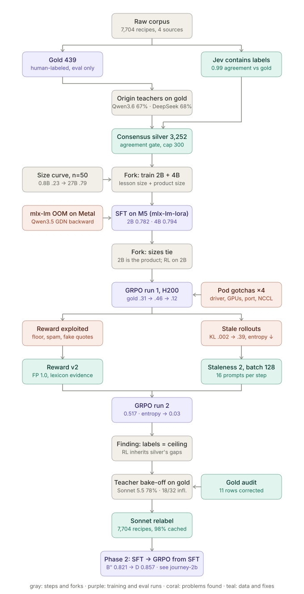

# prime-recipe-classifier

Post-training a 2B model to classify recipes against a controlled culinary taxonomy — origin tradition path (hierarchical classification like Europe > Spain > Basque) plus ingredient-class `contains` — on Prime Intellect's stack (`verifiers` v1 environment, `prime-rl` GRPO), with every arm evaluated on one human-labeled gold set under one scoring function.

There were many interesting parts of this process; the one that mattered most for training is what the RL loop exposed about the reward, the data and the training setup, and how each finding changed the next run. The dated record is in [`LOG.md`](LOG.md); the analysis in
[`TRAINING.md`](TRAINING.md).



## Day 2 went back to the data

Day 1 ended with every arm converging on the same ceiling: the 2B and 4B SFT models were within noise of each other (0.782 vs 0.794), the RL run plateaued below both, and all of them found at most 9 of the 32 recipe influences (the harder challenge) in the gold set while the training labels carried an influence on only 0.6% of recipes. 

It became clear we need to look at the label data on the silvers. Scaling parameters or RL steps against those labels
could only converge on them. So the next step was better data: measure every candidate teacher against
the human gold, pick the best, relabel. Along the way the verifier flagged `contains` labels in the gold set itself that it
could not ground (vanilla extract-only labelled with `alcohol`, gelatin as `pork`); 11 gold rows were corrected and every arm re-scored. 

The relabel moved the influence rate from 0.6% to 6.6%, the SFT ceiling from 0.78 to 0.82, and gave RL something it could amplify.


(Detailed version with the numbers behind each box: [`journey-2.svg`](journey-2.svg).)

## Reward V1 Hacking vs V2

> In V1, the reward paid a flat fee (0.5 on `contains`) for saying "incomplete," and the model learned to use it as an escape hatch on every recipe.

V2 only pays for "incomplete" when the gold label also says the ingredient list is incomplete; claiming it otherwise scores 0.

> In V1 a missed allergen cost 2.0 but an extra false one cost only 0.5 — for allergens a miss is worse than an over-warning.

The model's precision was too low for that ratio: padding the list with extra allergens scored higher than an honest list with one miss. V2 doubled the false-positive cost to 1.0, counts duplicates, and zeroes the score above 10 classes.

> In V1, the evidence check only asked whether the quoted string was a real ingredient, not whether that ingredient supports the claimed allergen, so `"egg": "tur dal"` passed.

It was a real ingredient, just not tied to the allergen — so every padded entry came with "evidence." V2 requires the quoted ingredient to be in the lexicon for the claimed class, so the reward is tied to a legitimate ingredient→allergen link.

The model found all three: it said "incomplete" everywhere, padded the allergen list when it didn't, and pointed at random ingredients as evidence. Its training score went up while its accuracy on the human gold set fell from 0.46 to 0.12 — that divergence is the signature of reward hacking.

## Results — 2B unless noted, reward v2, audited gold

| arm | 439 gold | 350 public subset | notes |
|---|---|---|---|
| A. base (Qwen3.5-2B, v3 prompt) | 0.244 | 0.249 | zero-shot |
| B. SFT, consensus silver (LoRA, 2 epochs, M5) | 0.782 | 0.785 | |
| B. SFT 4B, same data | 0.794 | 0.802 | not distinguishable from 2B (paired diff +0.013 ± 0.010) |
| C. GRPO from base (prime-rl, 1× H200, 23 steps) | 0.517 | — | +0.27 from reward alone; plateaued (entropy 0.39 → 0.03) |
| **B″. SFT on Sonnet-5.5 silver** (full FT, prime-rl, 1× H200, 33 min) | **0.821** | — | origin 0.725 · contains 0.937 · depth 2.54 (gold ≈ 2.6); better labels moved the 2B more than doubling parameters did |
| B″-mac. same labels, LoRA r8 on 16 layers (mlx-lm-lora, M5, 95 min) | 0.782, 0.769 (two draws) | — | origin 0.702 · contains 0.880 · 16 influences emitted; gap to full FT is mostly `contains` (same labels) → LoRA capacity. Control: full-FT weights through MLX = 0.817, so the two eval stacks agree |
| **D. GRPO from B″** (prime-rl, 1× H200, T 1.2, 80 steps, 2 h 12 m) | **0.857** | — | origin 0.767 · contains 0.967 · influences 3 → 11 recipes; entropy 0.07 → 0.02; gold-150 peaked 0.866 at step 70 |

Reward = 0.55 · origin (hierarchical set-Jaccard over the taxonomy path, influence term) + 0.45 · contains
(recall-weighted, lexicon-grounded evidence). Specification and history in [`TRAINING.md`](TRAINING.md#reward-v2-2026-11-08--after-arm-c-exposed-three-exploits).

## What failed, and what changed

| observed | diagnosed as | changed |
|---|---|---|
| gold 0.46 → 0.12 while train reward rose; rollouts listing every class, quoting unrelated ingredients, always claiming `incomplete` | reward exploits: flat floor, FP cheaper than FN, substring "evidence" | reward v2: `incomplete` must match gold; FP cost 1.0; evidence must be a real ingredient *and* lexicon-supported for the class; spam cap |
| mismatch KL 0.002 → 0.39, grad norm 5 vs clip 1, repetition to the token cap | stale rollouts: single-GPU inference ran ~10× ahead of the trainer | `max_staleness` 8 → 2, batch 64 → 128 episodes |
| train reward flat at ~0.5, entropy → 0.03, one distinct answer per group | premature convergence; no advantage signal | arm D: start from SFT, rollout temperature 1.2 → entropy 0.07 → 0.02 *with* gold rising +0.036; no_signal groups 18% → 38% over the run |
| SFT influences 5/32, RL influences 0/32 | labels are the ceiling: consensus silver had an influence on 0.6% of recipes (gold 7.3%) | teacher bake-off on gold (table below) → Sonnet 5.5 relabel → silver at 6.6% → B″ 0.821 |
| local 27B teacher: 148/439 answers truncated with a 2k thinking budget, and the survivors scored *higher* | thinking budget fails selectively on the hard recipes → survivorship bias | re-run with thinking off (clean 0.808); never compare a truncated run's score |
| pod SFT at 15.8 s/step, MFU 8% | `micro_batch_size=1`: 32 sequences pushed through one at a time | micro-batch 8 → 6.2 s/step, MFU 23%, identical loss curve |
| `convert_dcp_to_bf16.py` TypeError on the SFT checkpoint | prime-rl tool iterates `_tied_weights_keys`, which is `None` on Qwen3.5-2B (tied embeddings) | one-line patch (`or []`); upstream PR candidate |
| 9 gold `contains` labels the verifier could not ground | gold errors (extract-only alcohol, gelatin ≠ pork) | audited 11 rows; all arms re-scored |

Teacher comparison on the 439 gold (`label_origin compare`): Qwen3.6-35B 67.4% exact / 11 influences · DeepSeek V4 68.5% / 12 ·
Claude Sonnet 5.5 78.1% / 18 · qwen3.6:27b (local) pending.

## What arm D says about SFT vs RL

> Recipe Influences are important for any fusion recipes that combine elements from different cultures. The recipe can have a primary technique or form from one culture, but influenced by another. Reversing this is incorrect and penalized. (See: https://saffronsifu.app/r/0PWWrU7RhpdsiWwvGrQQAF which is Japanese in form, but Korean in influence)

Using the same labels, same reward, same 2B. SFT on the Sonnet silver (B″) got 0.821 by imitation. GRPO from that checkpoint, with no
new labels, added +0.036 by comparing its own samples. Where the gain came from: origin +0.042 (more exact paths on fusion and
regional recipes), `contains` +0.030 (fewer spurious classes), and influences emitted on 11 recipes instead of 3 — a behaviour
the SFT model produced on 0.7% of outputs although 6.6% of its training rows carried one. RL amplified a rare behaviour 3.7×
because the reward's influence term made the one sibling that emitted an influence beat the seven that did not. 

> Classification Depth is a hierarchy like South Asian > Indian > Punjabi instead of just South Asian, or just Indian, or just Punjabi, which each get partial credit in the reward function if present, and any incorrect depth at any level is zero credit.

What RL did not do: deepen paths (2.54 → 2.48; the 10% depth bonus is too small against the Jaccard's shallow-path safety), or close the
teacher gap (origin 0.767 vs Sonnet's 0.843 on the same gold — the headline 0.857 includes `contains`, whose labels are better
than the origin labels). RL from the base model alone (arm C) reached 0.517.

## Teachers measured on the gold set

Origin labels for the training set come from an LLM teacher, so the teacher's own accuracy against gold is the ceiling
for everything trained on it. Each candidate labeled the 439 gold recipes with the same prompt (`label_origin compare`):

| teacher | where | primary exact | origin score | gold influences found (of 32) | emitted | notes |
|---|---|---|---|---|---|---|
| Qwen3.6-35B-A3B | Prime Inference | 67.4% | 0.761 | 11 | 13 | 19 parse errors |
| DeepSeek V4 | Prime Inference | 68.5% | 0.784 | 12 | 14 | first silver (consensus with Qwen3.6 → 0.6% influences) |
| Qwen3.6-27B, thinking on, 2k budget | local Ollama, M5 | 80.1% *of 291 answered* | 0.874 | 2 of 7 | 4 | **148 truncated** — survivorship bias: the same model with room to finish scores 0.826 |
| Qwen3.6-27B, thinking off | local Ollama, M5 | 72.6% | 0.808 | 17 | 19 | ~77 output tokens/recipe; the free local option |
| Qwen3.6-27B, thinking on, 6k budget | local Ollama, M5 | 74.5% | 0.826 | 17 | 21 | all 439 answered; ~1,865 output tokens/recipe (24×) for +0.018 |
| **Claude Sonnet 5.5** | Anthropic API | **78.1%** | **0.843** | **18** | 33 | chosen; relabeled 7,704 recipes with 98% of input tokens from prompt cache |

Two things this table taught: a teacher's *influence precision* and *recall* are different axes (the 27B names an influence
only when sure, 89% precision; Sonnet finds one more but at 55%); and a thinking budget that truncates is not a worse
version of the same measurement, it is a different sample. Caveat on all rows: the teacher was chosen *by* its gold score,
so the table mildly overfits the 439; a held-out slice would make the choice clean.

> We may revisit the gold varieties and increase fusion recipe % and more diversity to see if that creates overfitting/memorization or generalization.

# Phase 3

## Taxonomy Depth

The next phase of training and reward will involve training depth recognition so that hierarchical categories in the taxonomy are met. For instance instead of stopping at two levels, `South Asian > Indian`, a dish like `Galouti Kebab` would be 4 levels: `South Asian > Indian > North Indian > Awadhi`.

## New High Level Taxonomy

There is ambiguity between `American | Contemporary | Fusion`. There was also a top level category called Unplaced which meant it doesn't have a deep cultural origin, but we didn't like this label so we changed `Unplaced -> Global`. `Foundational`, `Contemporary` and the new `Fusion` are one level down from Global.

We decided that Fusion isn't a primary dish + influence (like Bulgogi Burgers is American + Korean Influence in ingredients only) instead it must be a `Dish x Dish` which means two different dishes fused together like Chicken Tikka Pesto Penne (Global > Fusion || Italian + Indian influences). In the latter case it is a cross between two Dishes, not just adding an ingredient (like gochujang) or a marinade, but rather two dishes "Fused" together, each still there as itself. The test: could you lift the second dish out and serve it on its own?

Fusion, Contemporary and American is the perfect blurred area that can illuminate the training, training reward, and consistency/inconsistency that we are trying to train through our taxonomy rules. 

## Phase 3 Dataset

| | Day 2 | Phase 3 |
|---|---|---|
| Training recipes | 5,066 | 5,774 |
| Test recipes, original gold | 439 | 439 |
| Test recipes, hard set (fusion, ownership, regional depth) | none | 224 |
| Training labels with a `Fusion` primary | 0 | 29 |
| Training labels with an influence | 148 | 207 |
| Training labels three levels deep or more | 2,157 | 2,671 |

Both gold sets are held out of training. The hard set and the newly sourced recipes are not redistributable, so they are not in this repo.

## Baseline before training

Before training anything new we scored the day-2 fine-tune (B″, full fine-tune on Sonnet labels) on the hard set, so Phase 3 has something to beat. Same weights, same sampling, same scorer. The hard set ran on the Mac (MLX) and the original gold on the pod (vLLM); the two stacks agree within noise on the 439 (0.817 vs 0.821).

| | Hard set (224), on the Mac | Original gold (439), on the pod |
|---|---|---|
| Overall reward | 0.735 | 0.821 |
| Origin | 0.607 | 0.727 |
| Contains | 0.892 | 0.937 |
| Exact origin match | 45% | 63% |

The hard set by the kind of recipe:

| Slice | Recipes | Origin score | Exact match |
|---|---|---|---|
| Un-named fusion | 30 | 0.285 | 13% |
| Ownership cases (adapted abroad, rewrites, two claimants) | 108 | 0.640 | 55% |
| Regional depth (one recipe per thin regional node) | 86 | 0.679 | 44% |

What the baseline says:

- **Fusion is where the old model fails outright.** It never answers `Fusion` (0 of 10) and offers an influence on 7 recipes where gold has 45.
- **Depth is not the problem we assumed.** Its answers are as deep as gold on average (2.65 levels vs 2.63). On the regional recipes it was exact on 38, stopped short on 17, and on 18 went to the right depth but picked the wrong node. The weakness is choosing the right region, more than daring to go deep.
- **The taxonomy and reward change did not move the old numbers.** Re-scoring the saved day-2 answers under taxonomy 0.4.0 and reward v3 gives B″ 0.821 and D 0.857, the same as recorded, so Phase 3 can be compared directly on the original 439.

What we expect from Phase 3, written down before the run:

- **Original 439:** about level with D (0.857), within the ~0.02 noise band. Those labels barely changed.
- **Hard set:** a clear gain over 0.735, mostly from fewer wrong-region answers and from `Fusion` being answered at all.
- **Influences:** more of them offered than D's 11, because reward v3 charges less for a wrong guess.

One caution on reading the result: a single evaluation of 439 recipes has about ±0.013 of sampling noise, more on 224, and much more on the 30 fusion recipes. Only large moves on the small slices mean anything.


## Phase 3 results

One fine-tune on the Phase 3 data, then 80 steps of GRPO from it with reward v3. Same schedule as arm D, so the differences are the labels, the data and the reward.

| Model | Original 439: reward | origin | exact | Hard 224: reward | origin | exact |
|---|---|---|---|---|---|---|
| B″, day-2 fine-tune | 0.821 | 0.727 | 63% | 0.735 | 0.607 | 45% |
| D, day-2 GRPO | 0.849 | 0.749 | 64% | 0.765 | 0.641 | 47% |
| Phase 3 fine-tune | 0.821 | 0.728 | 63% | 0.738 | 0.634 | 47% |
| **E, Phase 3 GRPO** | 0.837 | 0.739 | 66% | **0.786** | **0.696** | **53%** |

Origin on the hard set, by kind of recipe:

| Slice | D | E |
|---|---|---|
| Ownership cases (108) | 0.685 | 0.73 |
| Un-named fusion (30) | 0.317 | 0.47 |
| Regional depth (86) | 0.698 | 0.73 |

What moved:

- **The hard set, on origin.** +0.055 over D and +0.09 over the day-2 fine-tune. The hard set was evaluated twice and the two runs agree to 0.001 on reward.
- **Influences.** E matches a gold influence exactly on 15 to 20 of the 45 hard recipes that have one; D matched 6. It adds one where gold has none once.
- **Fusion.** E answers `Fusion` 6 times on the hard set (3 right, 3 wrong; gold has 10) and finds all 3 on the original gold with the right parents. No earlier model ever answered it.

What did not:

- **The original 439 is level with D** (0.837 vs 0.849), as predicted before the run. The gap is in `contains` (0.956 vs 0.971); origin is within noise and exact match is 2 points higher.
- **The fine-tune alone did not beat the day-2 fine-tune on reward.** It gained on origin and lost the same amount on `contains`. The GRPO stage recovered most of that.

What we learned about the method:

- **The in-training score misled us.** The 150-recipe gold sample logged every 10 steps moved from 0.868 to 0.872 over the run, which looked like nothing. The full evaluation shows +0.06 origin on the hard set. A sample drawn only from the easy set, blending both reward terms, cannot see where the model is improving.
- **This model has two jobs and one of them belongs elsewhere.** `contains` is handled better by a dedicated system. Phase 4 drops it from the fine-tune and the reward and trains origin only.

### How the gain arrived

The same hard-set evaluation, run on weights saved during the GRPO stage:

| GRPO step | Hard 224: reward | origin |
|---|---|---|
| 0 (the Phase 3 fine-tune) | 0.738 | 0.634 |
| 60 | 0.776 | 0.682 |
| 70 | 0.775 | 0.677 |
| 80 | 0.786 | 0.696 |

Most of the gain is in by step 60. Step 70 to 80 still adds 0.019 on origin, almost all of it on the ownership recipes (64 to 70 exact of 108), against a repeatability of about 0.002 for this evaluation. The model was still improving when the run stopped, so 80 steps was too short. `Fusion` is the exception: the model answers it 6 times (3 right) at all three steps, and the fusion slice peaked at step 60.

### What broke on the way

Three failures, none of them about the model. Each cost time, and each is now a rule in the setup scripts.

- **Disk.** On prime-rl `4c12d15` a trainer checkpoint for the 2B model is about 25 GB. The fine-tune kept four and the first GRPO checkpoint filled a 200 GB disk at step 20. The disk had been sized from day 2, when a whole run took 33 GB. Fix: `--trainer.ckpt.keep-last 1`, and one final checkpoint for the fine-tune.
- **Lost weights.** Enlarging the disk on the rented pod restarted it and erased everything on the local disk, including the finished fine-tune, which had not been copied off yet. The fine-tune was rerun (it is seeded, and the losses matched to three decimals). Fix: every finished artefact goes to the persistent volume and to a second machine as soon as it exists.
- **Memory at start-up.** Continuing the run from step 80 was killed twice. The cause was container RAM. The environment config uses `runtime.type = "subprocess"`, which starts one Python process per attempt in flight. While the trainer is busy with its slow first step, the dispatcher raises concurrency to about 4,350, and we counted 4,536 Python processes holding about 256 GiB against a 251 GB limit. The 80-step run had passed through the same spike with slightly fewer in flight. Next run: cap the number of attempts in flight and watch RAM through the first step. The continuation to 120 steps was not completed.

# Phase 4 (plan, written before the run)

**Question.** Does the 2B model get better at origin and influences when that is its only job?

In the product, `contains` comes from a dedicated classifier (TypeSafe Jev, 0.99 against gold). The 2B model does not need to produce it. Phase 3 gave one hint that the two jobs compete: the Phase 3 fine-tune gained on origin and lost the same amount on `contains`. Phase 4 tests that directly.

**What changes, and only this:**

| | Phase 3 (arm E) | Phase 4 |
|---|---|---|
| Model answer | origin, contains, evidence | origin only |
| Instructions | origin rules, taxonomy tree, contains rules | origin rules and taxonomy tree, word for word; contains rules removed |
| Reward | 0.55 origin + 0.45 contains | origin (same v3 function) |
| Recipes, origin labels, taxonomy | Phase 3 | the same |
| Base model, learning rates, batch, temperature | arm E | the same |

**Data.** Nothing from days 1, 2 or Phase 3 is edited or removed. Phase 4 gets its own copy (`data/dataset_p4_origin/`, `data/sft_p4_origin/`) built from the Phase 3 files, with the `contains` labels left out of the copy. The environment gains a `mode` setting (`full` by default, `origin` for Phase 4), so every earlier config still runs as it did.

**Runs.**

1. Fine-tune 2B on the origin-only copy, same schedule as Phase 3 (340 steps).
2. GRPO from it for 160 steps, saving weights at 60, 80, 100, 120, 140 and 160.
3. The same two steps at 4B, only if the 2B result is clear.

**How it is judged.** On origin only, on both gold sets: origin score, exact match, the three hard-set slices, influences found, `Fusion` found. The comparison with arm E is made at **step 80**, where the two runs differ in one thing. Steps beyond 80 answer the separate question of what a longer run adds. The final step is fixed in advance at 160; the hard set is not used to pick a checkpoint.

The in-training evaluation changes too: it reads the hard set as well as a sample of the original gold, and logs origin alone, so the curve shows what Phase 3's could not.

For a product-level number, the combined system is scored as Phase 4 origin plus Jev's `contains` under the Phase 3 reward, which is directly comparable with arm E's 0.786 and 0.837.

**Numbers to beat (arm E, origin):**

| | Original 439 | Hard 224 |
|---|---|---|
| Phase 3 fine-tune | 0.728 | 0.634 |
| E, step 80 | 0.739, 66% exact | 0.696, 53% exact |

**Expectations, written down before the run:**

- **Fine-tune alone:** hard-set origin at or a little above 0.634. A fine-tune only imitates the labels, and the labels have not changed.
- **GRPO at step 80:** hard-set origin above 0.696. This is where the effect should show, because the whole reward, and so the whole training signal, is now about origin. In arm E a group of eight attempts could be ranked by an allergen slip.
- **A gain under 0.02 counts as no effect.** One evaluation repeats to about 0.002, but we have never measured how much two training runs differ, and it is certainly more than that.
- **Risk we expect to see:** more groups where all eight attempts score the same and teach nothing. That share rose from 18% to 38% during arm D with two reward terms; with one term it should be higher. If it passes about half, the next change is a larger group or a higher sampling temperature.
- **If nothing moves,** the two jobs were not competing at this size, and a single model doing both costs nothing. That is a result too.

## Layout

```
taxonomy.yaml                     246 origin nodes, 20 contains classes, derived diets, ingredient traps
env/recipe_tax/                   scoring (reward), lexicon, taxonomy loader, dataset build, SFT prep, teacher labeling
env/environments/recipe_classify/ verifiers v1 Taskset/Task; configs/ (vf-run local/ollama/mlx, prime-rl rl/sft/eval)
env/tests/                        14 tests on the reward
scripts/                          pod setup/sync (driver, GPU, port, NCCL gotchas scripted), eval runners, this export
data/                             publishable subset only (see Data)
LOG.md / TRAINING.md / TAXONOMY.md / OVERVIEW.md / PLAN.md
```

## Hardware and where each step ran

- **Mac (M5, 128 GB)**: all 439-recipe evaluations (base models via Ollama, fine-tuned models via `mlx_lm.server`), the size
  curve (Qwen3.5 0.8B → 27B zero-shot), SFT for 2B and 4B (`mlx-lm-lora`, LoRA r8 on 16 layers, ~1.7 h / ~3.2 h), the
  local 27B teacher evaluation, and all data/label tooling. Evals are fast because the ~3k-token system prompt is prefix-cached.
- **Rented 1× H200 (Prime Intellect compute, ~$6.7/h)**: GRPO with `prime-rl`, trainer and vLLM sharing the one GPU
  (`CUDA_VISIBLE_DEVICES=0,0`, filesystem weight broadcast); the B″ full fine-tune (`prime-rl sft`, 33 min) and its
  439-recipe eval through vLLM; arm D. The SFT trainer saves DCP checkpoints only — `tools/convert_dcp_to_bf16.py`
  produces the HF directory vLLM and arm D load.
- **Rented 1× H200 (RunPod), Phase 3**: the Phase 3 fine-tune (`prime-rl sft`, 36 min), arm E (80 GRPO steps, about
  75 s per step) and every Phase 3 evaluation through vLLM. Prime's own H200 pods were stuck in set-up that day. No
  credentials were shipped to the third-party pod, so every command there carries `--no-monitors.prime`.
- **Hosted APIs**: Prime Inference for the first two origin teachers (DeepSeek V4, Qwen3.6-35B); Anthropic API for the
  Sonnet 5.5 teacher (native Messages API with prompt caching: 98% of the 40M relabel input tokens were cache reads); TypeSafe Jev for `contains` labels.

## Reproduce

```bash
cd env && uv sync
uv run python -m pytest -q tests                                          # reward unit tests
uv run vf-validate recipe-classify                                        # gold self-scores 1.0
# baseline against a local Ollama model:
bash ../scripts/vf_run_ollama.sh qwen3.5:2b 350
# SFT on Apple silicon (mlx-lm-lora; mlx-lm's own trainer OOMs on Qwen3.5's GatedDeltaNet backward):
uv run python -m recipe_tax.sft_prepare && mlx_lm_lora.train --model Qwen/Qwen3.5-2B --train --train-mode sft \
  --data ../data/sft --mask-prompt --batch-size 4 --gradient-accumulation-steps 2 --iters 1600 --learning-rate 1e-5 \
  --max-seq-length 3584 --grad-checkpoint --num-layers 16 --adapter-path ../runs/sft-2b
# SFT on the pod with prime-rl (full fine-tune), then export HF weights (the trainer only saves DCP):
uv run sft @ env/environments/recipe_classify/configs/sft-2b-sonnet.toml --no-monitors.prime
uv run python tools/convert_dcp_to_bf16.py outputs/<run>/checkpoints/step_320      # -> .../step_320/weights
# GRPO on one GPU with prime-rl (see configs/rl-2b.toml comments for the single-GPU flags):
CUDA_VISIBLE_DEVICES=0,0 uv run rl @ env/environments/recipe_classify/configs/rl-2b.toml --inference.vllm.gpu-memory-utilization 0.45
# Phase 3 on prime-rl 4c12d15 (flag names changed since day 2; each trainer checkpoint is ~25 GB, hence keep-last):
uv run sft @ env/environments/recipe_classify/configs/sft-2b-v04.toml --no-monitors.prime
CUDA_VISIBLE_DEVICES=0,0 uv run rl @ env/environments/recipe_classify/configs/rl-2b-v04.toml --deployment.num-train-gpus 1 \
  --deployment.num-infer-gpus 1 --inference.vllm.gpu-memory-utilization 0.45 --trainer.ckpt.keep-last 1 --no-monitors.prime
```

The Phase 3 commands run as written only with the full private dataset. With this repo's public subset, point the configs at
`data/dataset_v04/` here and rebuild the fine-tuning files with `python -m recipe_tax.sft_prepare --dataset-dir ../data/dataset_v04 --out-dir ../data/sft_v04`.

## Data

- **Gold** (`data/gold/gold.jsonl`, 350 of 439): human-labeled by the author; the policy never trains on it.
- **Train** (`data/dataset/`, `data/dataset_dsv4/`, `data/dataset_sonnet/`): silver labels — `contains` from TypeSafe Jev
  (0.99 vs gold), origin from LLM teachers. Consensus set (two-teacher agreement), single-teacher DeepSeek set (no gate),
  and the Sonnet 5.5 set that B″ and arm D train on (influence on 6.6% of rows vs 0.6% in the consensus set).
- **Phase 3** (`data/dataset_v04/`): taxonomy 0.4.0 labels. 4,457 of the 5,774 training recipes and 350 of the 439 gold
  recipes are here. Not here: the 224-recipe hard set and the 700 newly sourced training recipes (scraped from recipe sites,
  not redistributable), and the app captures described below. `data/dataset/`, `dataset_dsv4/` and `dataset_sonnet/` stay as
  the record of days 1 and 2; their labels use taxonomy 0.3.3 (`Unplaced`), so the environment's default is now `dataset_v04`.
- **Raw** recipes: Food.com (CC0) and Wikibooks Cookbook (CC BY-SA 3.0; each record carries its `source` URL). The 89 gold and
  ~460 train recipes captured from the author's own app are excluded from this repository; the private 439-recipe numbers are
  reported alongside the 350-recipe public numbers above.
- Labels and derived data in this repo: CC BY 4.0. Code: MIT ([LICENSE](LICENSE)).

## How this was built

Directed, labeled and decided by Jasdeep Jaitla; code and analysis written with Claude as a pair, over roughly one
weekend. Every decision, mistake and reversal is in [`LOG.md`](LOG.md) with a date — including the model's own errors
(a rename it claimed to have applied and had not; a reward design that RL took apart in 35 steps). 

## We also discovered a small bug in prime-rl

`tools/convert_dcp_to_bf16.py` is the only path from a prime-rl SFT checkpoint (DCP) to HF weights that vLLM or any other
loader can read. On Qwen3.5-2B it crashed, and the fix we tried first produced a *subtly wrong* export — the two halves of one bug:

1. **The crash.** The tool does `for key in getattr(model, "_tied_weights_keys", [])` to drop the duplicated output head of a
   tied-embedding model. On this model the attribute exists but is `None`, so the default never applies and Python tries to
   iterate `None` → `TypeError`. Qwen3.5-2B ties `lm_head` to `embed_tokens`, so the only models that hit this are exactly the
   ones the loop is for.
2. **The quiet half.** Patching it to `getattr(..., None) or []` makes the conversion run — but the loop is now a no-op, so the
   export carries `lm_head.weight` as a full copy of `embed_tokens`. vLLM loads that without complaint (we evaluated B″ at
   0.821 through it). `mlx-lm` refuses: `Received 1 parameters not in model: language_model.lm_head.weight`. An export that
   some loaders accept and others reject is worse than a crash, because you find out one stack later.

The fix the tool needs: when `config.tie_word_embeddings` is set and `_tied_weights_keys` is missing or `None`, drop
`lm_head.weight` (and its index entry) explicitly rather than trusting the attribute. The local workaround for an export that
already exists is to remove that one tensor from its shard and from `model.safetensors.index.json`; the weights are identical
to `embed_tokens`, so nothing is lost. After that the same file loaded in both stacks and scored 0.821 (vLLM) and 0.817 (MLX)
on the 439 gold — which is also how we confirmed the two eval stacks agree.

**Update, Phase 3:** at prime-rl commit `4c12d15` the tool converts the same model without a patch and the export has no
`lm_head.weight` entry, so both halves are fixed upstream.

Found at prime-rl commit `cbd3702`; the patched tool and its `.orig` are in `pod-archive/tools/` locally (not in this repo).
